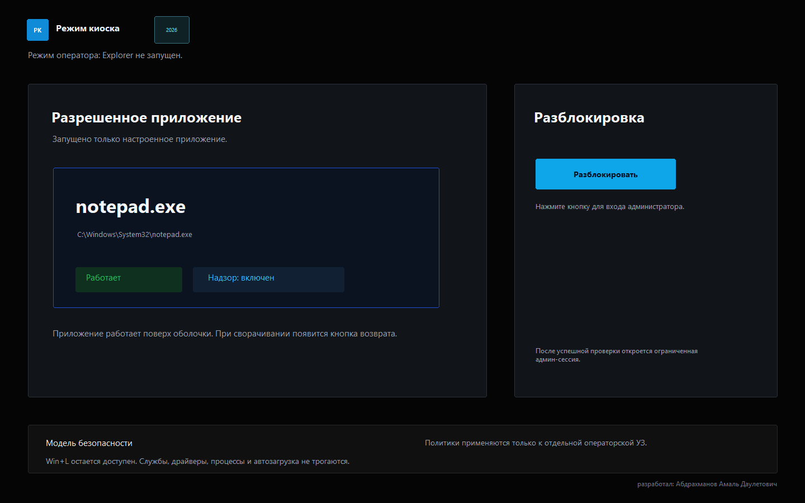
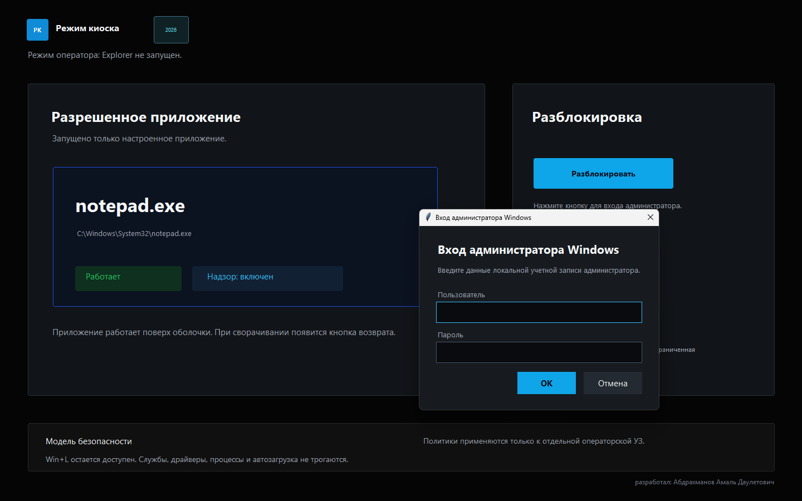
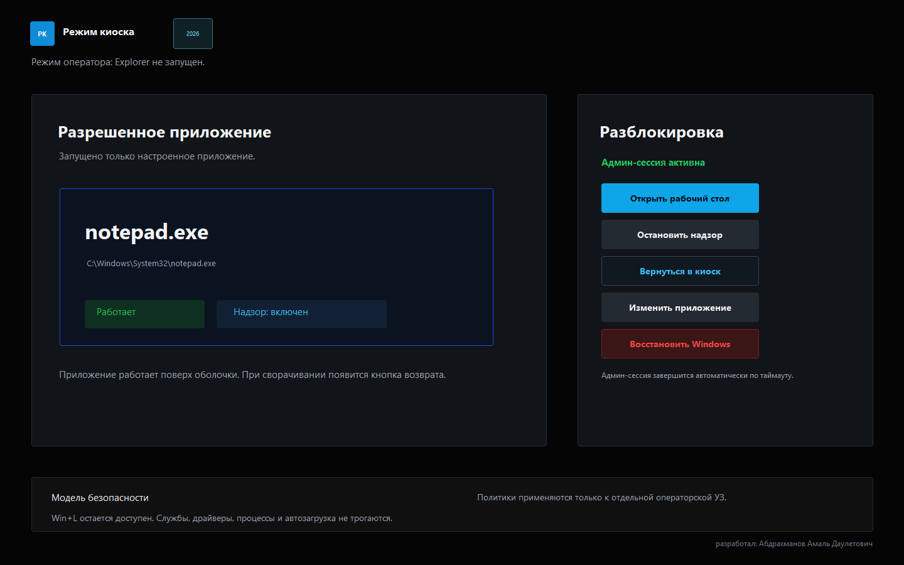

# Режим Киоска

> Историческое описание версии 2.0. Новая версия, испытания и загрузки находятся в [README 2.1](README.md).

**Режим Киоска** - настольная оболочка для Windows, которая запускает одно разрешённое Win32-приложение в отдельной операторской учётной записи.

Программа скрывает обычный рабочий стол оператора, останавливает `explorer.exe` в его сеансе, блокирует системные комбинации клавиш и следит за разрешённым приложением. Если приложение закрыто, watchdog запускает его снова. Если окно свёрнуто, оболочка показывает его состояние и кнопку восстановления.

> [!WARNING]
> Используйте киоск только в отдельной локальной учётной записи оператора без прав администратора. Не назначайте киоск основной учётной записи. До постоянной настройки обязательно проверьте ручное восстановление рабочего стола.

## Возможности

- запуск одного обычного `.exe` по выбранному пути;
- сохранение выбранного приложения между перезапусками;
- контроль одного экземпляра и перезапуск после закрытия;
- обнаружение свёрнутого окна и кнопка `Развернуть приложение`;
- запуск разрешённого приложения поверх оболочки;
- блокировка `Win`, `Win+R`, `Win+E`, `Win+X`, `Win+S`, `Win+D`, `Alt+Tab`, `Ctrl+Alt+Tab`, `Ctrl+Esc`, `Alt+Esc` и `Alt+F4`;
- сохранение работы `Win+L`;
- локальная авторизация учётной записью администратора Windows;
- временная административная сессия;
- смена разрешённого приложения только после авторизации;
- восстановление Explorer и обычного рабочего стола;
- журналы с ротацией без записи паролей и вводимого текста;
- отдельные Modern- и Legacy-сборки.

Программа не останавливает службы и драйверы Windows, не очищает автозагрузку, не завершает системные процессы массово и не сохраняет пароль администратора.

## Как выглядит программа

### Операторский режим



Оператор видит только состояние разрешённого приложения и кнопку разблокировки. Обычный рабочий стол, меню Пуск и панель задач не используются как оболочка киоска.

### Вход администратора Windows



Для разблокировки вводятся имя и пароль **локальной** учётной записи Windows. Поле домена отсутствует. Доступ получает только пользователь, входящий в локальную группу `Administrators`.

### Административная сессия



После успешной проверки доступны:

- открытие рабочего стола;
- остановка или запуск надзора;
- возврат в киоск;
- изменение разрешённого приложения;
- восстановление Windows.

Административная сессия автоматически завершается по таймауту.

## Выбор сборки

| Операционная система | Сборка |
|---|---|
| Windows XP SP1-SP3 x86 | Legacy x86 |
| Windows Server 2003 x86 | Legacy x86 |
| Windows 7 SP1 | Modern |
| Windows 8 и 8.1 | Modern |
| Windows 10 | Modern |
| Windows 11 | Modern |

Готовые архивы находятся в разделе [Releases](../../releases).

- `RezhimKioska-V2-Modern-Windows7-11.zip`
- `RezhimKioska-V2-Legacy-XP-x86.zip`
- `SHA256SUMS.txt`

Legacy распространяется только полной папкой. Нельзя копировать из архива один EXE без расположенных рядом DLL, `config` и других файлов.

## Подготовка

### 1. Создайте отдельного оператора

Создайте новую локальную учётную запись, например `KioskOperator`.

Требования:

- учётная запись локальная;
- она не входит в локальную группу `Administrators`;
- это не основная учётная запись владельца компьютера;
- в неё выполнен хотя бы один обычный вход, чтобы Windows создала профиль пользователя.

На новых версиях Windows учётную запись можно создать через `Параметры -> Учётные записи -> Другие пользователи`. На Windows XP и Windows 7 используйте панель управления или управление локальными пользователями.

### 2. Распакуйте подходящий архив

Рекомендуемые пути без кириллицы и пробелов:

```text
C:\KioskModern
C:\KioskLegacy
```

Не запускайте программу непосредственно из ZIP.

### 3. Проверьте наличие файлов

Modern:

```text
RezhimKioska-V2-Modern.exe
Configurator.exe
Restore.exe
config\kiosk.v2.json
```

Legacy дополнительно содержит `python27.dll`, DLL среды выполнения, каталоги Tcl/Tk и другие файлы. Они должны оставаться рядом с EXE.

## Первый запуск

1. Войдите в отдельную операторскую учётную запись.
2. Запустите `RezhimKioska-V2-Modern.exe` или `RezhimKioska-V2-Legacy.exe`.
3. При первом запуске разрешённое приложение ещё не настроено.
4. Нажмите `Разблокировать`.
5. Введите имя и пароль локального администратора Windows.
6. Нажмите `Изменить приложение`.
7. В стандартном окне Windows выберите нужный `.exe`.
8. Подтвердите выбор.

Путь сохраняется в:

```text
config\kiosk.v2.json
```

Выбор остаётся после закрытия киоска, выхода пользователя и перезагрузки Windows. Повторно выбирать приложение не требуется, пока администратор не изменит его.

Можно выбрать любое обычное Win32-приложение с расширением `.exe`. UWP и приложения Microsoft Store не поддерживаются.

## Работа оператора

После настройки киоск:

1. запускает выбранное приложение;
2. контролирует, чтобы не появлялось несколько экземпляров;
3. перезапускает приложение после закрытия или сбоя;
4. не перекрывает его окно при обычной работе;
5. показывает состояние `Свернуто`, если приложение свёрнуто;
6. разворачивает его по кнопке `Развернуть приложение`.

Обычный ввод текста в разрешённом приложении остаётся доступным.

## Разблокировка

1. Нажмите `Разблокировать`.
2. Введите только имя локального пользователя, например:

```text
Administrator
```

или имя другой локальной учётной записи, входящей в группу `Administrators`.

3. Введите пароль. Каждый символ отображается как `*`.
4. Нажмите `ОК`.

Неверный пароль или обычная учётная запись без административных прав не открывают административную сессию.

Пароль:

- не записывается в `kiosk.v2.json`;
- не сохраняется в реестре;
- не выводится в консоль;
- не записывается в журнал;
- не передаётся по сети.

## Смена разрешённого приложения

1. Нажмите `Разблокировать`.
2. Пройдите локальную авторизацию администратора.
3. Нажмите `Изменить приложение`.
4. Выберите новый `.exe`.
5. После подтверждения старый надзор останавливается, конфигурация обновляется и запускается новое приложение.

Оператор без авторизации изменить файл конфигурации через интерфейс не может.

## Постоянный запуск вместо Explorer

Сначала полностью проверьте ручной запуск и восстановление в операторской учётной записи.

Для постоянного режима Launcher назначается пользовательской оболочкой **только оператору**. Выполняйте команды из операторской учётной записи, а не из основной.

Modern:

```cmd
reg add "HKCU\Software\Microsoft\Windows NT\CurrentVersion\Winlogon" /v Shell /t REG_SZ /d C:\KioskModern\RezhimKioska-V2-Modern.exe /f
```

Legacy:

```cmd
reg add "HKCU\Software\Microsoft\Windows NT\CurrentVersion\Winlogon" /v Shell /t REG_SZ /d C:\KioskLegacy\RezhimKioska-V2-Legacy.exe /f
```

После выхода и повторного входа вместо `explorer.exe` запускается `RezhimKioska`.

> [!IMPORTANT]
> Не выполняйте эти команды в основной административной учётной записи. Значение находится в `HKCU` и применяется именно к текущему пользователю.

## Восстановление рабочего стола

### Из интерфейса

1. Нажмите `Разблокировать`.
2. Авторизуйтесь локальным администратором.
3. Нажмите `Восстановить Windows`.

Если существует созданная установкой резервная копия, Restore откатывает сохранённые настройки. Затем запускается Explorer.

### Из административной учётной записи

Modern:

```cmd
C:\KioskModern\Restore.exe recover-desktop --apply
```

Legacy:

```cmd
C:\KioskLegacy\Restore.exe recover-desktop --apply
```

Команду нужно запускать с повышенными правами администратора Windows.

### Ручное удаление пользовательской shell

Войдите в операторскую учётную запись или загрузите её профиль из административной учётной записи, затем удалите только пользовательское значение `Shell`:

```cmd
reg delete "HKCU\Software\Microsoft\Windows NT\CurrentVersion\Winlogon" /v Shell /f
start explorer.exe
```

После выхода и повторного входа Windows снова использует обычный `explorer.exe`.

Не удаляйте системный раздел Winlogon целиком и не изменяйте `HKLM`, если это не требуется отдельным утверждённым планом установки.

## Конфигурация

Основной файл:

```text
config\kiosk.v2.json
```

Ключевые параметры:

```json
{
  "operatorUser": "KioskOperator",
  "allowedApplication": {
    "configured": true,
    "path": "C:\\Windows\\System32\\notepad.exe",
    "arguments": "",
    "workingDirectory": "C:\\Windows\\System32",
    "restartOnExit": true,
    "singleInstance": true,
    "bringToFront": true,
    "startMaximized": false,
    "restoreIfMinimized": false
  }
}
```

Рекомендуется изменять путь кнопкой `Изменить приложение`, а не вручную.

Журналы по умолчанию:

```text
C:\ProgramData\Kiosk\Logs
```

## Сборка из исходного кода

Репозиторий содержит полный исходный код Modern и Legacy.

### Modern

Требуется 32-битный Python 3.8:

```powershell
python -m pip install -r requirements-modern-build.txt
powershell -NoProfile -ExecutionPolicy Bypass -File .\v2\scripts\build-modern.ps1
```

Скрипт до первого запуска PyInstaller проверяет наличие всех entrypoint/spec/config
файлов и запускает Modern-тесты вместе с контрактами сборки. В GitHub Actions та же
сборка автоматически выполняется на Windows с Python 3.8 x86 при каждом обновлении
`main`.

### Legacy

Требуется 32-битный Python 2.7 и совместимый PyInstaller 3.2.1:

```powershell
powershell -NoProfile -ExecutionPolicy Bypass -File .\v2\scripts\build-legacy.ps1
```

Legacy-скрипт также выполняет проверку полного набора входных файлов и тесты до
начала упаковки EXE.

Legacy-toolchain должен находиться в `v2\toolchain\pyinstaller-3.2.1` либо передаваться параметром `-Toolchain`. Готовая Legacy-сборка публикуется в Releases, поэтому для обычного использования Python не нужен.

## Проверка исходников

Modern:

```powershell
python -m unittest discover -s v2\tests\modern -p "test_*.py"
```

Legacy:

```powershell
& "$env:LOCALAPPDATA\Python27-x86-portable\python.exe" -m unittest discover -s v2\tests\legacy -p "test_*.py"
```

Перед публикацией последней версии пройдено:

- 196 Modern-тестов;
- 91 Legacy-тест.

## Ограничения

- Windows XP и Windows Server 2003 давно не поддерживаются Microsoft.
- Legacy предназначен только для x86.
- Modern не запускается на Windows XP и Windows Server 2003.
- UWP и Microsoft Store не поддерживаются.
- Home-редакции Windows не дают гарантий AppLocker и Shell Launcher уровня Enterprise.
- `Ctrl+Alt+Del` не перехватывается небезопасными способами. Ограничения системного экрана должны задаваться политиками Windows.
- Защита киоска не заменяет физическую безопасность, BitLocker, обновления Windows и правильно настроенные права на папку программы.

## Безопасность

- Используйте отдельного оператора без административных прав.
- Храните программу и разрешённый `.exe` в папках, недоступных оператору для изменения.
- Проверяйте SHA-256 архивов по `SHA256SUMS.txt`.
- Перед изменением shell создавайте резервную копию.
- Храните `Restore.exe` и эту инструкцию доступными из обычной административной учётной записи.
- После каждого теста выполняйте Restore/Undo и проверяйте обычный рабочий стол.

## Автор

Разработал: **Абдрахманов Амаль Даулетович**

## Лицензия

Проект распространяется по лицензии [MIT](LICENSE).
