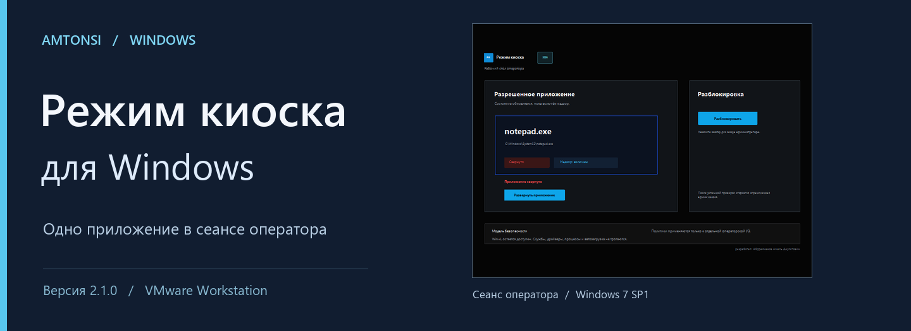
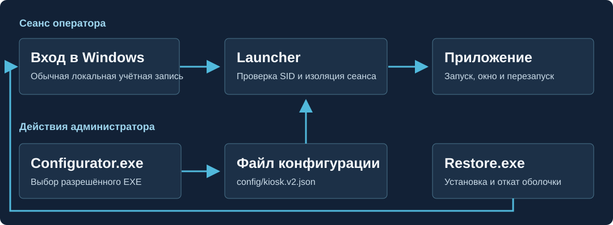

# Режим Киоска 2.1 для Windows



Запускаем одно выбранное Win32-приложение в отдельной локальной учётной записи. Если оператор закроет приложение, киоск запустит его снова. Если оператор свернёт окно, киоск покажет кнопку восстановления. Администратор может сменить приложение, приостановить надзор и вернуть рабочий стол.

Это продолжение проекта Амаля Абдрахманова [Amtonsi/Rezhim-Kioska](https://github.com/Amtonsi/Rezhim-Kioska), основанное на [ревизии dd6ead9](https://github.com/Amtonsi/Rezhim-Kioska/tree/dd6ead9697a8ceed7f916fc287887c3baae0b52f). Здесь публикуем исходники версии 2.1, готовые комплекты и результаты испытаний в VMware Workstation.

## Скачать

| Рабочее место | Самораспаковывающийся EXE | Переносимый ZIP |
|---|---|---|
| Windows 10 / 11 x64 | [Modern x64 · EXE](https://github.com/Amtonsi/Rezhim-Kioska-2.1/releases/download/v2.1.0/RezhimKioska-2.1.0-Windows10-11-x64.exe) | [Modern x64 · ZIP](https://github.com/Amtonsi/Rezhim-Kioska-2.1/releases/download/v2.1.0/RezhimKioska-2.1.0-Windows10-11-x64.zip) |
| Windows 7 SP1 | [Compat x86 · EXE](https://github.com/Amtonsi/Rezhim-Kioska-2.1/releases/download/v2.1.0/RezhimKioska-2.1.0-Windows7-Compat-x86.exe) | [Compat x86 · ZIP](https://github.com/Amtonsi/Rezhim-Kioska-2.1/releases/download/v2.1.0/RezhimKioska-2.1.0-Windows7-Compat-x86.zip) |
| Windows XP x86 | [Legacy x86 · EXE](https://github.com/Amtonsi/Rezhim-Kioska-2.1/releases/download/v2.1.0/RezhimKioska-2.1.0-WindowsXP-Legacy-x86.exe) | [Legacy x86 · ZIP](https://github.com/Amtonsi/Rezhim-Kioska-2.1/releases/download/v2.1.0/RezhimKioska-2.1.0-WindowsXP-Legacy-x86.zip) |

EXE распаковывает тот же комплект, что и ZIP. После извлечения запускаем загрузчик из папки вместе с конфигурацией, Configurator и Restore. Python на рабочем месте устанавливать не требуется. Версии ОС и пройденные сценарии приведены в [протоколе VMware](docs/VMWARE-2.1.md). Цифровая подпись у релизных файлов отсутствует. Для проверки загрузки используем [контрольные суммы SHA-256](https://github.com/Amtonsi/Rezhim-Kioska-2.1/releases/download/v2.1.0/SHA256SUMS.txt).

## Первый запуск

1. Из административной учётной записи создаём стандартного локального пользователя `KioskOperator`. Один раз входим под ним и выходим, чтобы Windows создала профиль. Сохраняем доступ к отдельной административной учётной записи для восстановления.
2. Администратор извлекает комплект в отдельную папку, например `C:\Program Files\RezhimKioska`. Разрешаем оператору чтение и запуск. Изменять EXE, DLL и конфигурацию могут только администраторы. Если оператор называется иначе, указываем его локальное имя в поле `operatorUser` в `config\kiosk.v2.json`.
3. Проверяем платформу и файл конфигурации. Для Modern и Compat открываем командную строку в каталоге программы и выполняем команды ниже. Для XP заменяем имя EXE на `RezhimKioska-V2-Legacy.exe`. `start /wait` дожидается завершения графического EXE, код `0` означает успех.

   ```cmd
   start "" /wait RezhimKioska-V2-Modern.exe --platform-check
   echo %ERRORLEVEL%
   start "" /wait RezhimKioska-V2-Modern.exe --check-config
   echo %ERRORLEVEL%
   ```

4. Входим в **отдельный сеанс оператора** и запускаем загрузчик без аргументов. При первом входе приложение ещё предстоит выбрать. Нажимаем **Разблокировать**, вводим данные локального администратора и нажимаем **Изменить приложение**. Выбираем EXE. Для записи настройки Windows может запросить подтверждение повышения или повторный ввод учётных данных.
5. Закрываем разрешённую программу и дожидаемся её перезапуска. Проверяем сворачивание и кнопку **Развернуть приложение**. Через **Разблокировать → Открыть рабочий стол** завершаем ручной сеанс и проверяем меню «Пуск» и панель задач.

## Постоянная оболочка и возврат к Explorer

Оператор должен один раз войти в систему до установки. Из отдельной административной учётной записи открываем **повышенную командную строку** в каталоге распакованного комплекта. Перед назначением постоянной оболочки завершаем сеанс оператора.

```cmd
Restore.exe dry-run
echo %ERRORLEVEL%
Restore.exe install --apply
echo %ERRORLEVEL%
```

Продолжаем после кода `0`. `dry-run` проверяет входные параметры. При `install --apply` сохраняем исходные параметры оператора в `state\backup-v2.json`, применяем права доступа и политики, затем назначаем Launcher пользовательской оболочкой. При следующем входе оператор попадает в киоск. Каталог установки и резервную копию сохраняем до отката. Для повторного применения настроек есть `Restore.exe repair --apply`.

Чтобы отменить постоянную установку, завершаем сеанс оператора и выполняем из того же каталога в повышенной командной строке администратора:

```cmd
Restore.exe restore --apply
echo %ERRORLEVEL%
```

После кода `0` снова входим под оператором и проверяем исходный рабочий стол. **Открыть рабочий стол** в интерфейсе завершает только текущий сеанс киоска. Команда `recover-desktop --apply` возвращает Explorer в сеансе вызова. Для отмены оболочки при будущих входах используем `restore --apply`, которому нужна резервная копия.

## Что изменилось

- **Первый запуск и выпуск.** В архиве Modern 2.0 был сохранён путь к Telegram на диске разработчика. Теперь упаковка требует точного совпадения с шаблоном, проверяет `configured: false` и сверяет файлы, извлечённые из обоих форматов.
- **Проверка оператора.** Перед изменением рабочего стола сверяем идентификаторы безопасности учётной записи, токена процесса и владельца интерактивного сеанса. При запуске из чужого или административного сеанса Launcher возвращает код `5`. При ошибке старта выполняем аварийный откат уже применённых действий.
- **Надзор.** Учитываем путь к EXE, пользователя и сеанс. Исправлен случай, когда процесс из другой папки с тем же именем получал статус разрешённого. Для 32-битного приложения на 64-битной Windows учитываем перенаправление `System32`. Интерфейс показывает ожидание запуска, конфликт и остановку после серии сбоев.
- **Установка и восстановление.** Команды установки и ремонта доступны в поставляемом `Restore.exe`. При повторной установке сохраняем первоначальную копию. Для вышедшего из системы оператора помощник загружает и выгружает реестр его профиля средствами Win32. Проверка прав доступа учитывает представление, которое возвращает сама Windows.
- **Выход в рабочий стол.** Исправлен аварийный выход Tcl/Tk при закрытии окна из обработчика кнопки. После восстановления киоск запускает Explorer с правами оператора. Сообщение о повторном появлении Explorer сбрасывается при явном возврате в киоск.
- **Среда выполнения.** Современная x64-сборка использует CPython 3.14.10. Для неё и Compat применяем PyInstaller 6.22.3 с исправлением загрузки кода через подмену окружения. Исправили остановку Legacy-сборки, которую вызывала проверка имени EXE в Python 2.7. Журнал по умолчанию находится в локальной папке данных оператора.

## Как устроен киоск



Launcher управляет сеансом и перезапуском программы. Configurator записывает выбор администратора. Restore сохраняет и восстанавливает исходные параметры оболочки оператора. Проверки SID, обработка сбоев и последовательность отката разобраны в [схеме переходов](docs/ARCHITECTURE-2.1.md).

## Возможности и ограничения

Киоск управляет оболочкой, окном и процессом в сеансе оператора. Разрешённое приложение сохраняет собственные возможности, включая открытие файлов и запуск дочерних программ. Для рабочего места, где нужно запрещать исполнение постороннего кода на уровне ОС, дополнительно применяем поддерживаемую политикой организации конфигурацию Windows. Справка Microsoft: [Shell Launcher](https://learn.microsoft.com/windows/configuration/shell-launcher/) и [Assigned Access](https://learn.microsoft.com/windows/configuration/assigned-access/).

На Windows 7 при ручном запуске Winlogon может вновь запустить Explorer между проверками киоска. Это наблюдалось в VMware. Для постоянного рабочего места используем установку оболочки в профиль оператора. XP и Windows 7 требуют отдельной оценки рисков. Legacy включает Python 2.7 и старый загрузчик PyInstaller, для которого сохраняется известный риск при запуске с повышенными правами. Храним комплект и все его зависимости в каталоге под контролем администратора. [Бюллетень PyInstaller](https://github.com/pyinstaller/pyinstaller/security/advisories/GHSA-9fxf-4qw3-ghmr).

## Исходники и документация

| Материал | Где смотреть |
|---|---|
| Структурная схема, состояния, авторизация и откат | [Архитектура и логика работы](docs/ARCHITECTURE-2.1.md) |
| Версии Windows, сценарии, результаты и снимки экрана | [Испытания в VMware](docs/VMWARE-2.1.md) |
| Повторная сборка и выпуск EXE из исходников | [Инструкция по сборке](docs/BUILD-2.1.md) |
| Полные исходники приложения | [Modern](v2/modern), [Legacy](v2/legacy), [тесты](v2/tests), [сценарии сборки](v2/scripts) |
| Форматы конфигурации, резервной копии и переходы состояний | [Контракты V2](v2/contracts) |
| Предшествующий выпуск и материалы | [README версии 2.0](README-v2.0.md) |

**Автор исходного проекта** — Абдрахманов Амаль Даулетович. Код проекта распространяется по [лицензии MIT](LICENSE).
