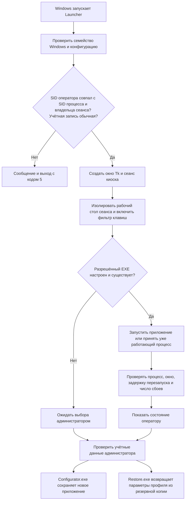

# Как устроен «Режим киоска» 2.1

После входа оператора Launcher запускает выбранный EXE и следит за ним. Конфигурация хранится в `config/kiosk.v2.json` рядом с программой. Настройка постоянной оболочки и смена приложения выполняются отдельными процессами с правами администратора.

## Где искать код

| Назначение | Modern | Legacy |
| --- | --- | --- |
| Запуск оболочки и создание зависимостей | [launcher.py](../v2/modern/kiosk_v2_modern/launcher.py) | [launcher.py](../v2/legacy/kiosk_v2_legacy/launcher.py) |
| Проверки Windows и вызовы Win32 | [platform](../v2/modern/kiosk_v2_modern/platform) | [platform](../v2/legacy/kiosk_v2_legacy/platform) |
| Сеанс, надзор и установка | [app](../v2/modern/kiosk_v2_modern/app) | [app](../v2/legacy/kiosk_v2_legacy/app) |
| Смена разрешённого EXE | [configurator.py](../v2/modern/kiosk_v2_modern/configurator.py) | [configurator.py](../v2/legacy/kiosk_v2_legacy/configurator.py) |
| Административная командная строка | [restore_entrypoint.py](../v2/modern/kiosk_v2_modern/restore_entrypoint.py) | [restore_entrypoint.py](../v2/legacy/kiosk_v2_legacy/restore_entrypoint.py) |
| Экраны и обработка кнопок | [ui](../v2/modern/kiosk_v2_modern/ui) | [ui](../v2/legacy/kiosk_v2_legacy/ui) |

Семейства собираются раздельно. Legacy сохраняет синтаксис Python 2.7 и совместимые с XP вызовы Windows. Структура конфигурации, резервной копии и допустимые переходы между режимами заданы в общих [контрактах V2](../v2/contracts). Файлы сборки EXE находятся в [v2/build](../v2/build).

## От входа оператора до запуска программы

1. `launcher.py` различает служебные проверки и интерактивный запуск. Ключи `--platform-check` и `--check-config` завершаются до создания операторского окна. При обычном запуске `app/bootstrap.py` читает конфигурацию и вызывает `InteractiveOperatorGuard` до создания окна и включения изоляции.
2. `platform/interactive_operator.py` находит локальную учётную запись из `operatorUser`. Защита сверяет её SID с владельцем токена процесса и SID пользователя интерактивного сеанса Windows. Заблокированы отключённые учётные записи, запуск через `runas` в чужом сеансе и членство в локальных администраторах. SID группы администраторов проверяется даже в отфильтрованном токене UAC. Поведение проверки закреплено в [тестах запуска](../v2/tests/operator_safety_cases.py).
3. `app/controller.py` исполняет переходы из [behavior-cases.json](../v2/contracts/behavior-cases.json). При входе в операторский режим `platform/desktop_isolation.py` проверяет идентификатор сеанса перед обработкой Explorer и окон оболочки. `platform/keyboard_guard.py` устанавливает клавиатурный хук. Если запуск прерывается после начала изоляции, `app/session.py` последовательно пытается снять хук, остановить изоляцию, показать окна и вернуть Explorer в текущем сеансе. Ошибка одного шага допускает выполнение остальных. Повторное закрытие повторяет неудавшиеся действия.
4. `app/process_supervisor.py` ведёт учёт контролируемого процесса и применяет параметры `restartOnExit`, `restartDelayMs`, `maxRestartAttempts` и `restartWindowSeconds`. Отдельные результаты различают конфликт процессов, передачу управления от загрузчика, ожидание рестарта и исчерпание попыток. `app/application_runtime.py` добавляет состояние окна. `app/session.py` передаёт результат в `ui/scene.py` для отображения. У свёрнутого приложения появляется кнопка восстановления. При конфликте показываются PID, при ошибке запуска — сведения, полученные от надзора.

## Права оператора и администратора

После нажатия «Разблокировать» `platform/admin_auth.py` проверяет локальные учётные данные в Windows. `app/admin_auth_service.py` вводит задержку при повторяющихся ошибках. Успешный вход открывает административные действия в интерфейсе до истечения настроенного таймаута. Сам Launcher продолжает работать под оператором. Изоляция рабочего стола сохраняется и во время административной сессии.

Для смены программы `platform/admin_actions.py` запускает `Configurator.exe configure-application` с глаголом Windows `runas`. Конфигуратор проверяет права, открывает диалог выбора и сохраняет конфигурацию. После успешного завершения Launcher перечитывает файл и применяет новый путь. Для восстановления вызывается отдельный `Restore.exe`. На системах с UAC административный помощник может вызвать системный запрос повышения.

## Постоянная оболочка и откат

Администратор распаковывает пакет в постоянную папку, выбирает приложение и создаёт профиль оператора первым входом в Windows. За административные команды этого пакета отвечает `Restore.exe`. Команда `dry-run` проверяет входные данные, права, наличие профиля и выводит план. Для установки с записью используется `install --apply`.

`app/install_service.py` получает SID оператора и расположение его профиля. Перед изменением прав и реестра служба сохраняет исходные параметры в `state/backup-v2.json`. В переносимом пакете EXE уже находятся на диске. Установка проверяет комплект файлов, применяет ACL и политики профиля, затем записывает Launcher в пользовательское значение `Winlogon\Shell`. `app/transaction.py` проверяет результат каждого шага. Если возникает ошибка, выполненные операции откатываются в обратном порядке. Результат содержит идентификаторы операций, у которых откат завершился ошибкой.

При `restore --apply` служба проверяет резервную копию и сопоставляет сохранённого оператора с SID локальной учётной записи. Затем восстанавливает права и значения реестра. При восстановлении из панели администратора повышенные права получает дочерняя утилита для отката постоянной настройки. После успешного отката лаунчер снимает ограничения и запускает Explorer от имени вошедшего оператора. При ручном запуске без резервной копии лаунчер возвращает рабочий стол тем же способом. Отдельная команда `recover-desktop --apply` возвращает оболочку в сеансе вызова. Для постоянного возврата прежней оболочки при следующих входах используется `restore --apply`.

Изоляция Explorer и перехват клавиш управляют рабочим столом оператора. Контроль запуска произвольных дочерних программ требует отдельно настроенной политики контроля приложений Windows. Версии гостевых ОС и фактические результаты испытаний приведены в [README](../README.md).
