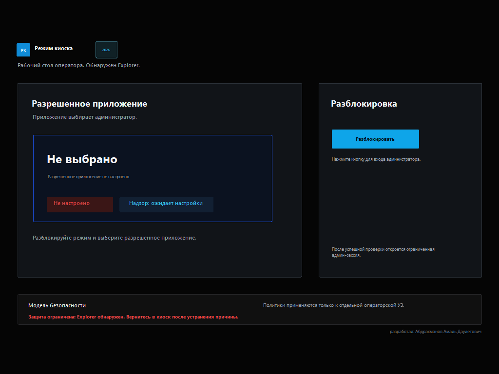
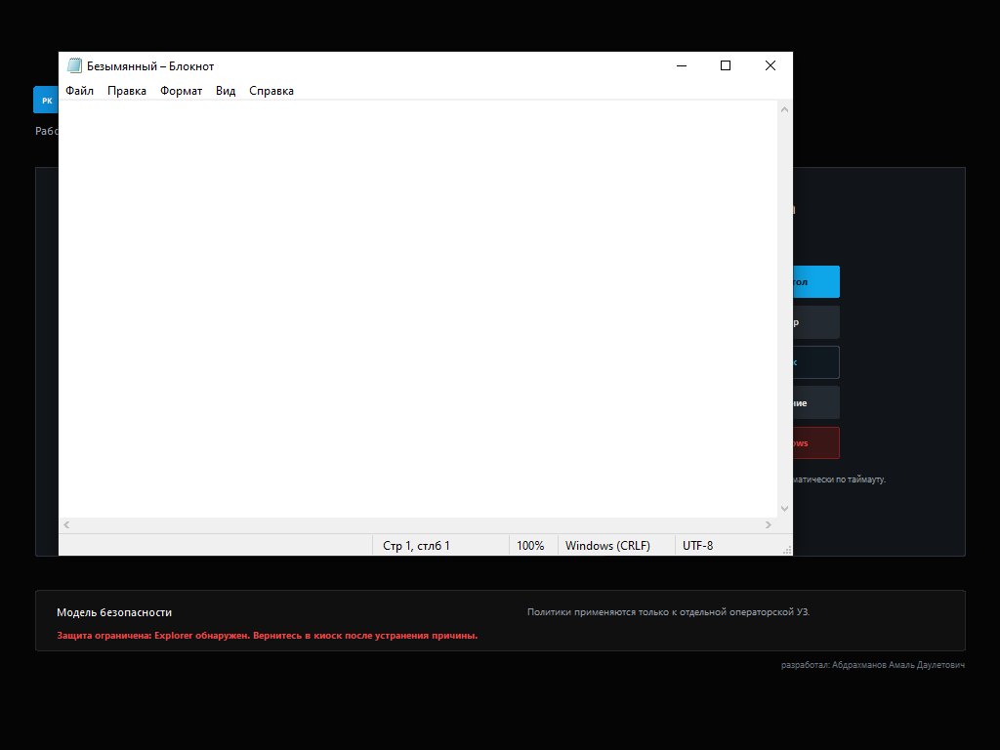
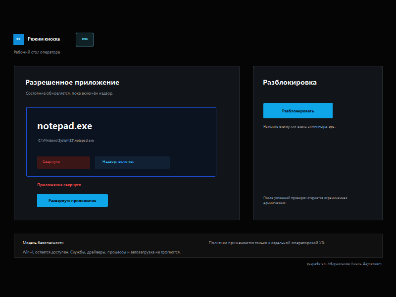
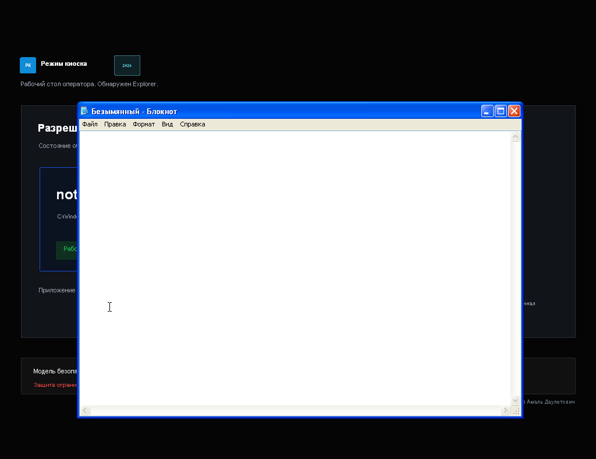

# Испытания Режима Киоска в VMware

16 ноября 2026 года проверили исходный выпуск [v2.0.0](https://github.com/Amtonsi/Rezhim-Kioska/releases/tag/v2.0.0) и сборки 2.1 на трёх изолированных копиях Windows в VMware Workstation. Использовали обычную локальную учётную запись оператора и отдельную локальную административную запись. Работу киоска оценивали по действиям в графическом сеансе, PID процессов, состоянию пользовательской оболочки и результатам повторного входа.

| Система | Как проверяли | Что подтвердили |
|---|---|---|
| Windows XP Professional SP2 x86, 5.1.2600 | Гостевая ОС, комплект Legacy | Операторский экран, перезапуск Блокнота, сворачивание и восстановление окна, административные действия и выход в Explorer |
| Windows 7 Ultimate SP1 x64, 6.1.7601 | Гостевая ОС, 32-битный Compat под WOW64 | Надзор за Блокнотом, постоянная оболочка при входе, авторизация и открытие рабочего стола |
| Windows 10 Education 22H2 x64, 19045.6456 | Гостевая ОС, в том числе нативный Modern x64 | Первый запуск с пустой настройкой, выбор через UAC, перезапуск процесса и установка пользовательской оболочки |
| Windows 11 Pro 25H2 x64, 26200.9974 | Рабочая система, служебные проверки EXE | Проверка платформы и чтения конфигурации. Интерактивный вход оператора, изоляция и откат на Windows 11 остаются отдельным испытанием |

В ходе разработки использовали несколько последовательных сборок. Приведённые ниже PID относятся к конкретным прогонам. Финальные самораспаковывающиеся EXE запускали в соответствующих гостевых ОС. На Windows 11 дополнительно запустили все три самораспаковщика, сравнили извлечённые файлы с соответствующими ZIP и зафиксировали SHA-256 внутренних Launcher, Restore и Configurator. Оба служебных вызова Modern и Compat вернули `0`. У Legacy оба вызова вернули предусмотренный код `4` для неподходящей системы. [Протокол проверки финальных комплектов](evidence/packages.json).

## Что показал исходный выпуск 2.0

- Пакет Modern, скачанный из GitHub Releases, уже содержал `configured: true` и путь к Telegram на диске `F:`. На чужом терминале такой путь препятствует штатному первому выбору приложения. В 2.1 перед упаковкой сверяем весь файл с версионированным шаблоном.
- После настройки Блокнота надзор перезапускал его в каждой из трёх ВМ. После принудительного закрытия PID изменился с 1084 на 1260 в XP, с 2308 на 2912 в Windows 7 и с 5908 на 4036 в Windows 10. На Windows 10 изоляция завершила операторский Explorer с PID 3636, после выхода из киоска появился Explorer с PID 2752.
- При ручном запуске поверх Explorer на Windows 7 служба входа вновь создавала оболочку. Зафиксировали четыре разных PID Explorer с одним родителем Winlogon (PID 500), а также видимую панель задач. Для постоянного рабочего места испытали установку Launcher в профиль оператора и новый вход.
- Проверка двух запущенных копий одноимённого EXE из разных папок воспроизвела ошибку определения разрешённого процесса. В 2.1 учитываются путь образа, SID пользователя и номер сеанса. Для 32-битного Launcher на 64-битной Windows учли системное перенаправление пути к Блокноту.

### Сбои, найденные при выходе

В графическом сеансе XP воспроизвели ошибку Tcl при уничтожении окна из обработчика кнопки. На Windows 7 отказ также регистрировался в Tcl/Tk. На Windows 10 один из кандидатов x64 при завершении через «Восстановить Windows» вызвал ошибку в `tcl90.dll` и событие 1000 в журнале приложений. Перенесли исполнение команды кнопки за пределы текущего вызова Tk. Повторный тест на Windows 10 показал ещё одну независимую ошибку: Launcher завершился чисто, но Explorer отсутствовал. Исправили последовательность восстановления. Теперь помощник с повышенными правами откатывает параметры профиля, а Launcher запускает Explorer под учётной записью вошедшего оператора.

## Windows 10

В чистом комплекте x64 поле выбора приложения было пустым. Проверили отказ при запуске под неподходящей учётной записью (код `5`). Под оператором разблокировали панель учётными данными локального администратора, прошли запрос UAC и выбрали Блокнот через Configurator. После сохранения Блокнот открылся в операторском сеансе. Принудительное закрытие процесса с PID 5064 привело к запуску нового процесса с PID 4768.

*Первый запуск до выбора программы. На следующем снимке открыт Блокнот, выбранный через Configurator.*

Отдельно выполнили `dry-run`, `install --apply`, повторную установку, `repair --apply` и `restore --apply`. Каждая команда завершилась с кодом `0`. В реестре оператора проверили путь в кавычках к EXE в папке с пробелами. До и после повторной установки и ремонта SHA-256 исходной копии совпал (`c1a3336a8867302ef45e525b3a141517f69e14ed21a9e9b93d1f8a37babcdf8a`). После перезагрузки и входа с установленной оболочкой работали киоск и Блокнот (PID 1852), Explorer отсутствовал. После отката и следующей перезагрузки вернулся Explorer (PID 1920).

На Windows 10 с завершённым сеансом оператора также проверили x64-помощник при исходно выгруженном пользовательском реестре. После сухого прогона, установки, ремонта и отката временный куст отсутствовал. Файлы комплекта и ACL системного Блокнота совпали с исходными. [Вывод проверок](evidence/win10-offline.txt).

Финальный самораспаковщик запустили в гостевой Windows 10. Внутренний манифест подтвердил 13 файлов. Извлечённый Launcher запустился как постоянная оболочка и перезапустил закрытый Блокнот (PID 3892 → 2164). Затем в административной панели выбрали «Восстановить Windows» и прошли UAC. Все десять проверенных значений реестра вернулись в исходное состояние. Launcher завершился, а новый Explorer с PID 4012 принадлежал оператору. Новых аварийных событий Launcher не обнаружили. Две записи WER при входе оказались повторной отправкой отчётов предыдущих сборок. [Операторский экран финального EXE](images/v2.1/win10-final-operator.png) · [Рабочий стол после восстановления](images/v2.1/win10-final-restore.png).

После полной перезагрузки Windows 10 вошли тем же оператором. В его сеансе работал Explorer с PID 1796, киоск и Блокнот отсутствовали. [Итоговый протокол из гостевой Windows 10](evidence/win10-final.json).

## Windows 7

Проверили установку из административной учётной записи при завершённом сеансе оператора. Первый кандидат не мог выгрузить подключённый реестровый файл профиля. В исправленном помощнике вызывается Win32-функция `RegUnLoadKeyW`. Команды проверки и установки вернули `0`, появилась резервная копия. Значение `Winlogon\Shell` содержало путь к установленному Launcher.

При новом входе оператор попал сразу в киоск. Explorer отсутствовал. После завершения Блокнота (PID 1260) надзор открыл новый экземпляр (PID 1820). Проверили кнопку восстановления свёрнутого окна, вход в административную панель, возврат в операторский режим и повторную авторизацию. После команды «Открыть рабочий стол» оба процесса Launcher завершились, появился Explorer с PID 3832.

*Постоянная оболочка после входа. [Административная панель](images/v2.1/win7-admin.png) и [возврат в операторский режим](images/v2.1/win7-return-to-kiosk.png).*

После `repair --apply` и `restore --apply` (оба кода `0`) значение Shell снова отсутствовало. При следующем входе оператор увидел исходный рабочий стол и меню «Пуск». В проверке завершения киоска число диалогов Windows Error Reporting было равно нулю. [Снимок следующего входа после отката](images/v2.1/win7-restored-login.png).

В Windows 7 запустили финальный самораспаковщик из операторской записи. Все 13 файлов совпали с внутренним манифестом, обе служебные проверки Launcher вернули `0`. В ручном режиме надзор перезапустил Блокнот (PID 3548 → 452). После нажатия кнопки разворачивания Win32-функция IsIconic вернула False для окна Блокнота. При этом Winlogon продолжал перезапускать Explorer в промежутках между проверками киоска. Такое поведение воспроизводится и в финальном EXE. [Вывод проверок SFX на Windows 7](evidence/win7-final.txt).

Финальный комплект также прошёл отдельный цикл с постоянной оболочкой. После входа Winlogon запустил Launcher, Explorer отсутствовал, а надзор перезапустил Блокнот (PID 1088 → 3260). После разблокировки, возврата в киоск и повторной авторизации открыли рабочий стол. Оба процесса Launcher завершились, появился Explorer с PID 4588. После постоянного отката код команды был 0, значение Shell снова отсутствовало. При следующем входе работал Explorer с PID 3436, процессов киоска и диалогов WER было 0. [Административная панель финального Compat](images/v2.1/win7-final-admin.png).

## Windows XP

В тестовом профиле использовали заранее настроенный Блокнот. При включении киоска обычный Explorer с PID 136 завершился. После принудительной остановки Блокнота с PID 212 надзор открыл новый процесс с PID 304. Проверили восстановление свёрнутого окна, разблокировку административной панели, возврат в операторский режим, повторную авторизацию и открытие рабочего стола. После выхода появился Explorer с PID 1860, Launcher завершился с кодом `0`.

*Кнопка киоска вернула свёрнутый Блокнот на передний план. [Операторский экран](images/v2.1/xp-operator.png) и [рабочий стол после выхода](images/v2.1/xp-desktop.png).*

На этой же ВМ установили постоянную оболочку для стандартного оператора. Служебные команды `dry-run`, `install --apply` и `restore --apply` завершились с кодом `0`. После установки реестр администратора сохранил исходные значения, а в профиле оператора появились Shell и DisableTaskMgr. Войдя после перезагрузки, получили киоск (PID 1796) и Блокнот (PID 2008) без Explorer. После отката значения профиля оператора вернулись в исходное состояние. При следующей перезагрузке вошли в Explorer (PID 1528) без киоска. При проведении опыта потребовалось освободить место в заполненном журнале безопасности старого образа XP, предварительно сохранив его архив в тестовой ВМ. [Рабочий стол после отката и повторного входа](images/v2.1/xp-restored-login.png) · [Вывод гостевых проверок](evidence/xp-profile.txt).

На финальном Legacy Launcher из самораспаковщика в XP повторили интерактивный проход. Explorer исчез при входе в киоск, надзор перезапустил Блокнот (PID 1228 → 1920), а после выхода появился Explorer с PID 620. Проверили возврат в операторский режим и повторную административную авторизацию. Код выхода Launcher равен `0`. [Процессы и код завершения](evidence/xp-final.txt).

В испытании постоянного входа XP использовался промежуточный Launcher 2.1 и окончательный Restore. Сам финальный Launcher дополнительно проверили кнопкой «Восстановить Windows» в ручном режиме, без резервной копии установки. После подтверждения киоск завершился с кодом `0`, Explorer с PID 1648 запустился под стандартным оператором.

## Как повторить

### Автоматические проверки исходников

| Интерпретатор | Набор | Результат |
|---|---|---|
| CPython 3.14.10 x64 | Весь `v2/tests` | 383 из 383 |
| CPython 3.8.10 x86 | Тот же набор | 383 из 383 |
| CPython 2.7.18 x86 | Совместимый набор `v2/tests/legacy` | 103 из 103 |

Проверки включают контракт сборки, конфигурацию, определение оператора, обработку одноимённых процессов, переходы интерфейса и откат оболочки. Для унаследованного кода также прошли 196 тестов в `tests` и 84 в `legacy_tests`. Команды запуска и версии инструментов указаны в [инструкции по сборке](BUILD-2.1.md).

### Проверки на рабочем месте

1. Создайте снимок тестовой ВМ. В гостевой Windows заведите обычного оператора и отдельную административную учётную запись. Войдите под оператором один раз, затем завершите его сеанс.
2. Распакуйте комплект в отдельную папку под контролем администратора. Сверьте хеш скачанного файла с `SHA256SUMS.txt` в релизе. Проверьте `--platform-check` и `--check-config`. До первого выбора приложения в файле конфигурации ожидается `configured: false`.
3. Пройдите первый запуск из [инструкции](../README.md#первый-запуск). Зафиксируйте PID разрешённого приложения. Закройте только эту программу, дождитесь нового PID и проверьте восстановление свёрнутого окна кнопкой киоска.
4. Проверьте административную авторизацию, возврат к оператору и открытие рабочего стола. Для проверки постоянной оболочки завершите сеанс оператора. Из отдельной административной записи запустите `Restore.exe dry-run` и `Restore.exe install --apply`, затем снова войдите оператором. Проверьте окно программы и отсутствие Explorer именно в этом сеансе.
5. Завершите сеанс оператора и выполните `Restore.exe restore --apply` из исходной папки. Войдите оператором ещё раз и проверьте меню «Пуск», панель задач и исходное значение оболочки. Пустое значение в начале опыта должно вернуться к исходному состоянию.

## Границы проверки

В качестве разрешённой программы в ВМ использовали системный Блокнот. Результаты относятся к указанным редакциям, сервис-пакам и разрядности. Многопользовательский RDS, доменная авторизация, Windows on ARM, Windows Server, другие сервис-паки XP и отдельный сеанс Windows 11 этим испытанием не охвачены. Для приложений, которые передают работу другому процессу, следует отдельно повторить сценарии запуска, сворачивания и выхода. Эксплуатация Windows 10 22H2 после завершения обычной поддержки зависит от программы обновлений конкретного устройства. Ветви Python 2.7 и 3.8 завершили жизненный цикл. [Сведения Microsoft](https://learn.microsoft.com/en-us/lifecycle/announcements/windows-10-end-of-support) · [Статус версий Python](https://devguide.python.org/versions/).
